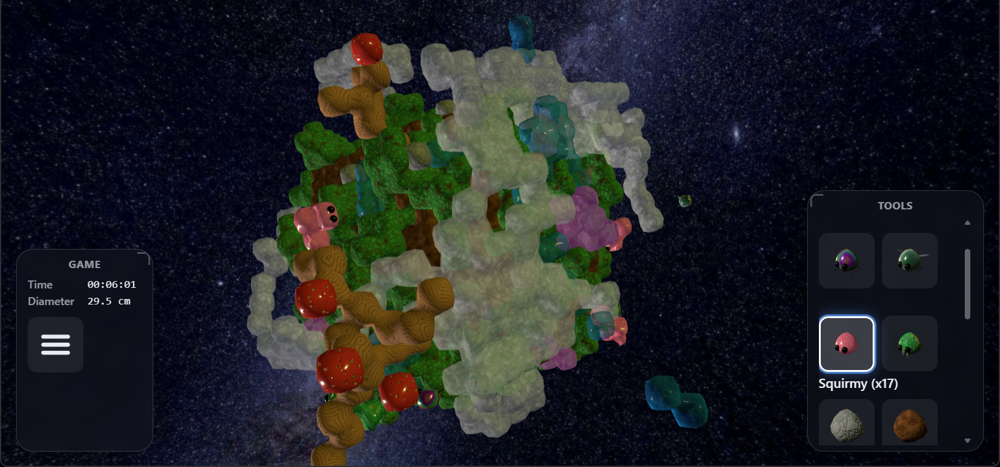

# Grid Game

A small living world built from space-filling blocks: **truncated octahedra** (14
neighbours), **rhombic dodecahedra** (12) or **cubes** (6), picked per world (see
[Grid modes](#grid-modes)). Place blocks and creatures,
then watch Water flow, trees grow Berries, and Crawlies, Buzzies, Squirmies and Slithers
roam and eat. React + Three.js; plays in a desktop browser, in WebXR with passthrough
(Meta Quest), or on a phone as a Cardboard-style stereo view.



## Run

Requires [Node.js](https://nodejs.org) 20+.

```bash
npm install
npm run dev       # http://localhost:5172/
npm run dev:xr    # HTTPS on your LAN, for Quest or phone
```

On a Quest, open the `dev:xr` address in the Quest Browser, accept the certificate warning,
and turn on **Options → XR**.

## Grid modes

**New** in the menu picks one of three space-filling grids:

| Mode | Cells (integer x, y, z) | Neighbours |
|---|---|---|
| Truncated Octahedron | all even or all odd | 14: `+X` … and `+X+Y+Z` … |
| Rhombic Dodecahedron | x + y + z even | 12: `+X+Y`, `+X-Z`, … |
| Cube | all even | 6: `+X`, `-X`, … |

Every block has an inradius of 1 cm. Directions are named by their axis signs and work the
same in every mode. Saves record their grid (`"grid": "to" | "rd" | "cube"`); older saves open
as Truncated Octahedron. See `src/game/grids.js`.

## Controls

| Action | Mouse / Keyboard | Gamepad | Quest Touch |
|---|---|---|---|
| Use tool | Left click | RT | Right trigger |
| Change tool (Options → Creative on; off, the tool is Select) | ← / → or 1–9, 0 | LB / RB | Right stick left/right (the right controller's ball shows the tool) |
| Steer the selected creature | WASD (Shift: away) | Left stick (L3: away) | Left thumbstick (held in: away) |
| Options (pauses) | Esc / Enter, or the gear (top left) | Start | The gear (Options, on the left controller), or Y |
| Orbit / zoom / pan | Left- or right-drag / wheel / middle-drag | Right stick / LT, RT / D-pad | Grip blocks: one hand drags, both rotate and scale (a grip on nothing does nothing) |
| Deselect | Right click (without dragging) | X | Select tool at empty space |
| Move / dock a panel | — | — | Grip a panel to take it; let go near the other controller to dock it. Double-tap a grip at a panel: dock it there; at nothing: undock. Triple-tap: dock every undocked panel on that controller. While gripping a panel, a creature or the build, that hand's thumbstick up / down pushes it away / reels it in, and left / right turns the build about that controller's ray |
| Carry a creature | — | — | Grip a creature (touching or pointing at it) to pick it up; let go to put it back in the nearest cells it fits, selected |

With a creature selected, on the XR controllers: **B** consumes, **A** excretes (hold either and aim with the left thumbstick), **Y** wanders, **X** waits (gamepad: **Y** consumes, **B** excretes, **View** waits; hold Y or B and aim with the left stick; keyboard: **E** consumes, **Q** excretes, held with WASD / the arrows to aim). Controlling a creature, WASD, the arrows, the gamepad's left stick or the XR left thumbstick move it (relative to your view of it; held in: straight away from you). In XR, taking control zooms the build in 4× about the creature's head, and going back to Observer zooms it back out. Controlling it, the Select tool still sends it somewhere (click / trigger a cell); with a creature selected, clicking another creature sends it after that one, following it as it moves, and Consume while pointing at one sends it to hunt that one down and eat it (if it eats that kind, like a Slither). Steering it, or Consume / Excrete, stops the walk.
The full table is under **Options → Controls** in the game. In a window, the **Control menu** (top right) has a **Controls** dropdown: the mouse (or gamepad) with each button labelled with what it does now, and the keys. In XR, **Options → Accessibility → Controller Guide** labels the controllers' buttons and sticks the same way.

## How it works

The world advances one **turn** per second (speed is adjustable in Options). Each turn,
detached chunks fall toward the origin, Water flows, Fog settles, Nimbus clouds drift and
rain, trees drink Water to grow Wood and Berries, Dirt soaks up Water to become Moss, and
creatures move, eat and fill their inventories. A creature that eats a Berry becomes
**Fertile** (pink ripples) until it mates. Left to itself, it goes after the first of its kind it sees and mates with it; selected beside another of its kind, **Mate** (X, gamepad A,
XR X; hold it and aim to pick which one) has them clamber over each other for 5 turns, and then it
carries an **Egg**. Excreted (or placed), the Egg, spotted in its parent's colour, hatches 5 turns
later into a young one of that kind (`MATE_TURNS`, `GESTATION_TURNS` in `src/game/blocks.js`).

Rules live in `src/game/sim.js`; block and creature definitions in `src/game/blocks.js`.

## Saves

**Save** writes JSON to `saves/` through a small API in the Vite server (`saves-api.js`);
**Load** lists those files. Without the API, the game downloads and opens `.json` files
instead. You can also drop a save file, or a world template (see `NEW_SCENE_TEMPLATE` in
`src/game/world.js`), onto the page.
